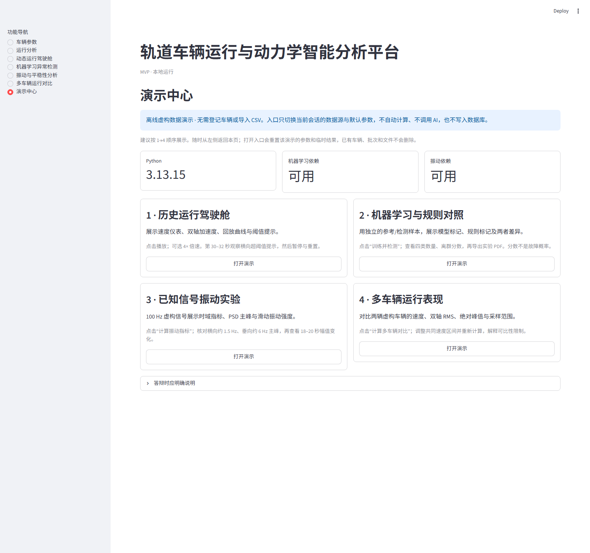
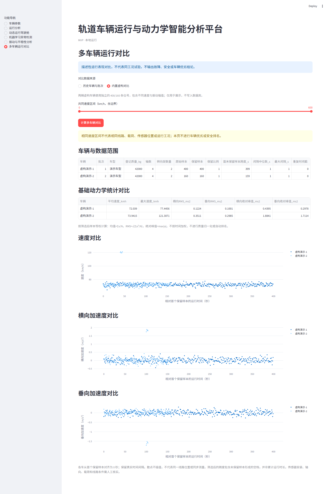
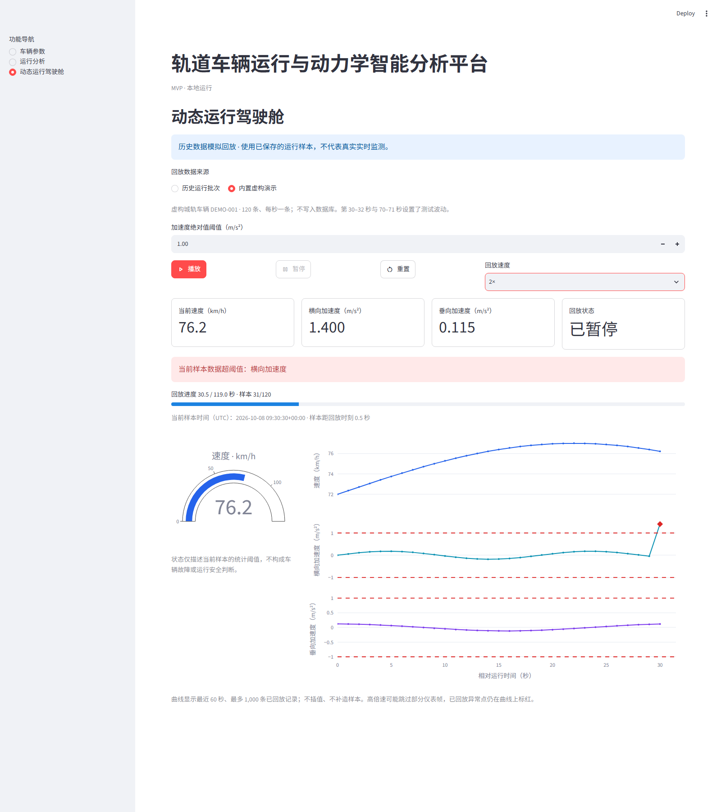
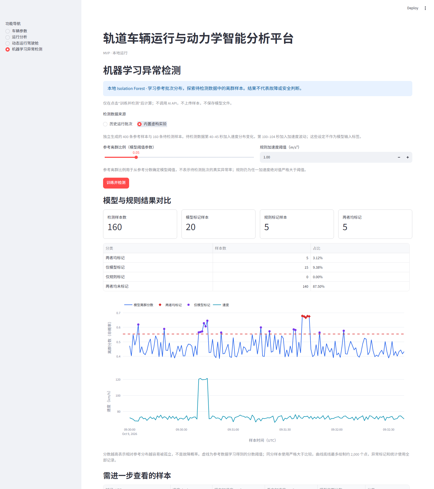
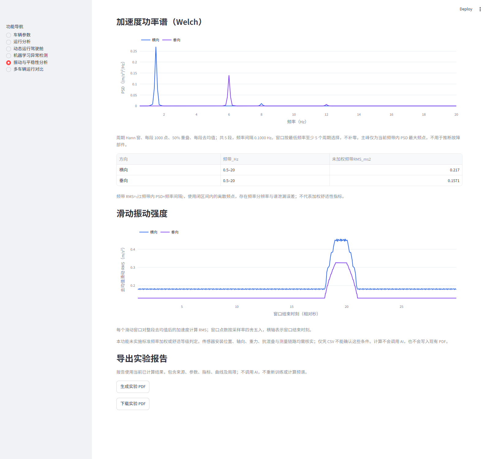
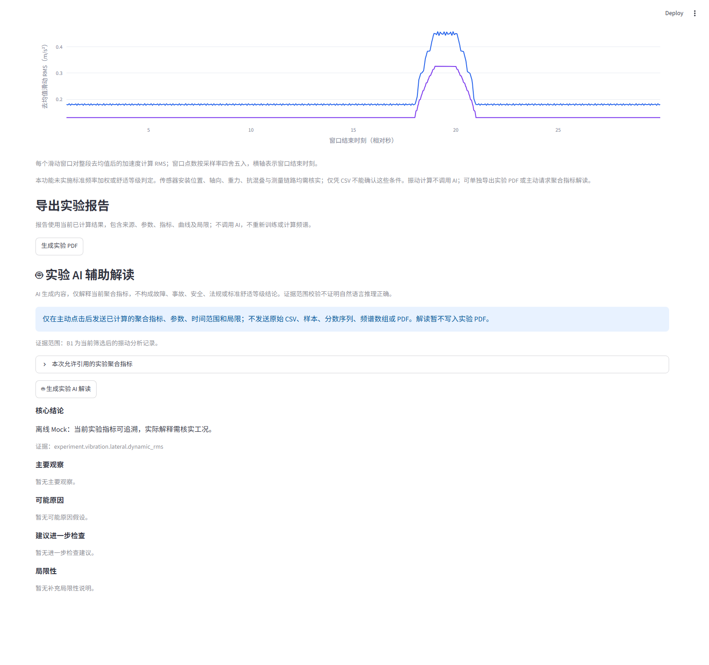
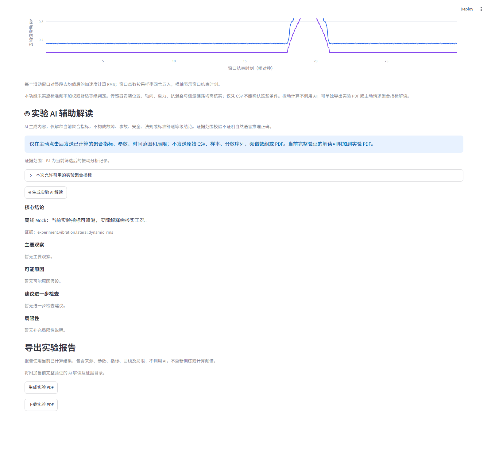
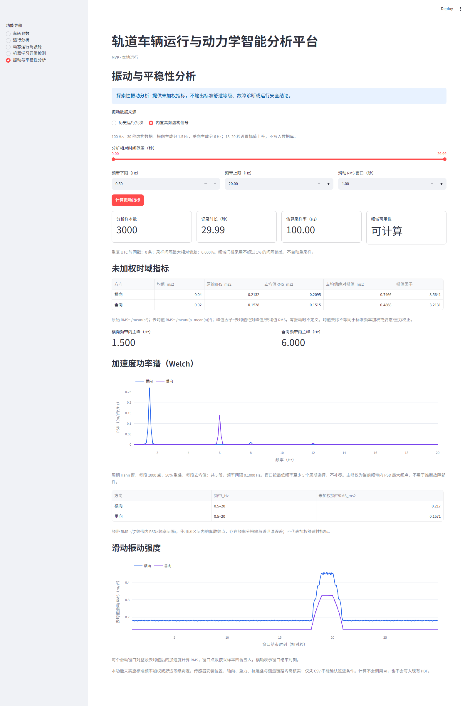

# 轨道车辆运行与动力学智能分析平台

RailVehicle-Lab 是一个用于查看和分析轨道车辆运行数据的本地 Web 平台。它以 Python 完成确定性计算，以 SQLite 保存车辆与运行记录，并提供可选的 AI 辅助解读。

## 核心功能

- **车辆参数管理：**新增、查看和编辑车辆基本参数，并保存到 SQLite。
- **运行数据导入：**上传 CSV 后检查字段、时间戳、车辆编号和数值范围；校验通过后预览并事务性导入，支持查看历史批次。
- **基础动力学统计：**查看速度及横向、垂向加速度统计指标、RMS、峰值和阈值统计。
- **时间范围筛选：**按 UTC 时间范围过滤单批次数据，页面指标、异常检测和曲线均使用筛选后的样本。
- **数据异常检测：**按可调加速度阈值识别异常点，并将相邻异常点合并为统计异常区段。
- **多批次对比：**比较同一车辆的两个或多个历史批次，并以相对运行时间绘制速度和加速度曲线。
- **单批次 PDF：**导出当前车辆、批次、时间范围和阈值对应的分析报告。
- **批次对比 PDF：**导出批次对比指标、曲线及适用的 AI 辅助解读。
- **AI 辅助解读：**在单批次、批次对比、机器学习实验或振动实验页面由用户主动触发，可选 OpenAI 或 DeepSeek Provider。
- **动态运行驾驶舱：**选择车辆和历史批次，播放、暂停、重置或调整倍速，查看随回放更新的速度仪表、双轴加速度、曲线和超阈值提示；支持不写入数据库的内置虚构演示。
- **机器学习异常检测：**可选本地 Isolation Forest，从参考批次学习分布，检测同一车辆另一批次中的离群样本，并与原有加速度规则并列展示；提供独立参考/检测数据的虚构实验。
- **振动与平稳性分析：**选择历史批次与相对时间范围，查看采样质量、去均值振动 RMS、峰值因子、滑动 RMS、Welch 功率谱及频带内主峰；采样条件不足时保留时域统计并停用频域结果。
- **多车辆运行对比：**选择 2–6 辆车及各自批次，在共同速度区间下对比速度、双轴加速度 RMS 和绝对峰值，展示车辆参数、样本保留比例及采样差异提示。
- **实验 PDF：**在机器学习和振动分析页导出当前计算结果，包含数据范围、参数、指标事实编号、指纹、曲线和适用边界。
- **演示中心：**四个入口自动选择内置虚构数据与默认参数，串联驾驶舱、机器学习、振动和多车辆对比，无需预先导入数据。

动力学统计、阈值异常和模型离群结果用于描述数据，不直接构成法规合规、车辆故障或铁路运营安全结论。

## 竞赛演示入口（V0.9 第一阶段）

启动应用后，在左侧选择“演示中心”。建议按四张卡片的顺序展示：

1. **历史驾驶舱：**打开演示后点击播放，使用倍速查看超阈值样本，演示暂停和重置。
2. **机器学习对照：**点击“训练并检测”，说明模型与规则标记的差别，再生成实验 PDF。
3. **振动实验：**点击“计算振动指标”，用已知虚构信号核对约 1.5 Hz / 6 Hz 主峰与幅值变化，再导出 PDF。
4. **多车辆表现：**点击计算，调整共同速度区间后重新计算，并说明相同速度区间不能证明相同工况。

入口只修改当前会话中的演示数据源与默认参数，不导入 CSV，不新增车辆或批次，不删除文件，不自动启动回放、训练模型或调用 AI。重新打开演示会清除该演示的临时结果；历史批次和历史振动范围选择不受清除影响。没有安装 `ml` / `signal` 可选依赖时，对应卡片禁用并提示安装，其他卡片仍可使用。

这套基础演示无需 API Key。若要展示真实 AI，必须另行配置并主动点击 AI 按钮；可能产生服务费用。虚构数据、模型分数和未加权振动指标不能作为真实诊断准确率、安全评价或标准舒适等级的证据。



## 技术架构

- **Streamlit** 提供本地交互页面、表单、数据表格、曲线和报告下载入口。
- **Python** 负责车辆和 CSV 校验、数据导入、动力学统计、时间筛选、异常识别、批次对比及 PDF 内容组装。
- **SQLite** 保存车辆、导入批次和运行记录；数据库首次启动时自动初始化。
- **AI 模块** 将 Python 已计算的结果组装为受限结构化上下文，通过 Provider 抽象选择 OpenAI 或 DeepSeek；模型输出再由本地 Schema 和证据校验器检查。

AI 是可选增强能力。AI 调用失败或结果校验失败时，基础分析、异常检测、批次对比和 PDF 报告仍可使用。

## 多车辆运行对比（V0.7）

在导航中选择“多车辆运行对比”，选择 2–6 辆已登记车辆，为每辆车选择一个历史批次，再设置共同速度区间并点击“计算多车辆对比”。没有多车辆数据时可选择“内置虚构对比”，不写入数据库，也不调用 AI。

页面展示车辆参数和数据范围、基础动力学统计表，以及按各车首个保留样本对齐的速度/双轴加速度散点。速度筛选包含上下边界；任何车辆没有保留样本时不生成部分对比。统计按样本等权计算，RMS 未去均值、不做频率加权。时间轴保留筛选产生的空档，不插值；跨度不等于累计运行时长。更改选择后旧结果消失，需要重新计算。

共同速度区间**不能保证相同工况**。页面提示车型、登记质量、轴数、转向架及采样间隔差异；线路、载荷、传感器安装等条件需人工核实。该功能不进行安全或车辆优劣排名，不做质量归一化，暂不接入 AI 或 PDF。

以下是两辆虚构车辆的实际对比界面：



## 动态运行驾驶舱（V0.4）

启动后，在左侧“功能导航”选择“动态运行驾驶舱”：

1. 选择“历史运行批次”，再选择车辆与批次；没有数据时也可直接选择“内置虚构演示”。
2. 设置加速度绝对值阈值，点击“播放”。速度仪表、当前指标和三条曲线随历史采样时间推进。
3. 使用“暂停”“重置”和 0.5×、1×、2×、4×、8× 倍速控制回放；播放到末尾自动停止，再次播放从头开始。
4. 当前样本超阈值时显示红色提示，曲线中的已回放超阈值样本以红色菱形标记。阈值使用严格比较 `abs(acceleration) > threshold`。

这是**历史数据模拟回放**，不连接车载设备，不代表真实实时监测。界面约每 0.5 秒刷新，回放按实际采样间隔推进；不插值，不补造数据，采样空档保留最后一个已观测样本，并显示该样本距当前回放时刻的时间差。曲线显示最近 60 秒、最多 1,000 条已回放记录。高倍速时部分仪表帧可能跳过。

内置演示包含 120 条每秒采样的虚构数据，第 30–32 秒横向加速度、第 70–71 秒垂向加速度有测试波动；使用默认 1 m/s² 阈值可观察提示。演示不新增车辆、不导入批次、不调用 AI。切换车辆、批次或数据来源后回放重置；离开页面时停止播放。驾驶舱状态仅描述统计阈值，不代表安全评价或故障诊断。

以下为内置虚构数据回放至横向加速度超阈值样本后暂停的实际界面，展示速度仪表、当前指标、进度和三条运行曲线。



## 机器学习异常检测（V0.5，可选）

基础安装不包含机器学习依赖。要启用本地模型，请在项目根目录运行：

```powershell
.venv\Scripts\python.exe -m pip install -e ".[ml]"
.venv\Scripts\python.exe -m streamlit run app.py
```

安装可选依赖或升级代码后，请重新启动已有的 Streamlit 进程，确保加载新依赖和模块。

在导航中选择“机器学习异常检测”，然后选择“历史运行批次”或“内置虚构实验”。历史模式需要同一车辆至少两个批次，分别指定参考批次和待检测批次；同一个批次不能同时被选中。设置参考离群比例与加速度规则阈值后，主动点击“训练并检测”。页面显示模型/规则标记数量、重合情况、离群分数曲线和需进一步查看的样本。切换输入、批次或参数后，旧结果失效，需要重新运行。

模型采用 scikit-learn 的 [Isolation Forest](https://scikit-learn.org/stable/modules/generated/sklearn.ensemble.IsolationForest.html)，使用速度、横向加速度、垂向加速度三个瞬时特征。仅在参考样本上拟合；待检测样本不参与训练。固定随机种子为 42、树数量为 100，每棵树最多抽取 256 条参考样本。参考离群比例用于学习分数阈值，不代表检测数据的真实异常率；页面使用 `-score_samples`，分数越高越偏离参考分布，**不是故障概率**。

参考批次至少 32 条，特征不能全部相同；每个输入批次最多 20,000 条。模型在内存中运行，不上传数据，不读取 API Key，不保存模型文件，也不会自动写入 AI 上下文或原有运行分析 PDF；用户可以主动导出独立的实验 PDF。没有安装 `ml` 可选依赖时，只显示安装提示，原有功能继续可用。

内置虚构实验使用独立生成的 400 条参考样本和 160 条待检测样本。第 40–45 秒设置速度分布变化，第 100–104 秒设置加速度波动；这些时间设定不作为训练标签。此实验用于展示模型和规则的差异，不作为真实车辆诊断性能评价。请确认实际参考/检测批次没有重复数据，且工况、车型与载荷等条件具有可比性。参考批次也不是经过认证的“正常车辆”数据；分布变化会产生误报，未标记样本同样不能被认定为安全。

以下为内置虚构实验的实际本地模型结果，展示标记数量、规则重合情况以及离群分数与速度曲线。



## 振动与平稳性分析（V0.6 基线，可选）

本功能使用 NumPy 和 SciPy。在项目根目录按需安装后，重新启动应用：

```powershell
.venv\Scripts\python.exe -m pip install -e ".[signal]"
.venv\Scripts\python.exe -m streamlit run app.py
```

在导航中选择“振动与平稳性分析”，选择车辆、历史批次和相对时间范围，或使用“内置高频虚构信号”。设置频带（默认 0.5–20 Hz）和滑动 RMS 窗口，点击“计算振动指标”。变更输入或参数会清除旧结果。

- 时域显示原始均值/RMS、去均值 RMS、去均值绝对峰值和峰值因子。去均值不等于标准频率加权、重力或姿态校正。
- 采样率按 UTC 相邻唯一时间间隔的中位数估计。频域要求无重复时间戳、间隔最大相对偏差不超过 1%、至少 64 个样本，记录至少覆盖最低频率的 5 个周期，且频带上限严格小于采样率的一半。这些是本项目的计算门槛，不是铁路标准条款。
- 功率谱采用 SciPy [Welch 方法](https://docs.scipy.org/doc/scipy/reference/generated/scipy.signal.welch.html)：周期 Hann 窗、50% 重叠、每段去均值。段长按最低频率至少 5 个周期自适应选择，不补零；显示实际频率间隔及分段数。
- 频带 RMS 使用闭区间频点的 `√(ΣPSD × Δf)` 估计，存在分辨率与谱泄漏误差。滑动 RMS 对整段去均值后的加速度计算，窗口点数按采样率四舍五入；不足 2 点或长于记录时不画滑动曲线。
- 采样率低、时间戳重复、抖动较大或时长不足时，保留时域指标并给出具体提示，不自动重采样或补造数据。最多支持 200,000 条记录。

内置演示为 100 Hz、30 秒虚构信号，横向主成分为 1.5 Hz、垂向为 6 Hz，第 18–20 秒设置幅值上升。它只用于验证指标、频谱和滑动强度展示，不写入数据库，不调用 AI。

**本版未实现标准频率加权、Sperling 指标或标准舒适等级。**瞬时均方根不能直接作为正式舒适性评价；实际应用还需确认传感器安装位置、轴向、测量链路、抗混叠与适用标准。结果不构成故障、安全或法规结论，也未自动写入现有 PDF。

## 实验报告导出（V0.8 第一阶段）

在“机器学习异常检测”或“振动与平稳性分析”页完成计算后，点击“生成实验 PDF”，再点击“下载实验 PDF”。报告直接使用当前已计算结果，不重新训练模型、不重新计算频谱，也不调用 AI。改变数据选择、参数或时间范围后，旧结果及下载入口失效，需要重新计算和生成报告。生成失败只显示安全提示，页面已有分析结果仍可使用。

- **机器学习报告：**参考/检测时间范围、样本数、树数量、随机种子、离群比例参数、模型与规则阈值、四类标记数量，以及分数和速度曲线。分数曲线中橙色虚线表示模型阈值，不表示故障概率。
- **振动报告：**当前样本范围、采样质量、频带及窗口参数、原始和去均值指标，以及适用的 PSD、主峰、频带 RMS 和滑动曲线。采样条件不足时仍可导出时域报告，明确说明频域停用原因，不生成虚构的频域结果。

报告提供输入与内容 SHA-256 指纹、本地车辆/批次编号（历史模式）及指标事实编号，方便追溯；指纹不能证明测量真实性。事实编号使用独立的 `report.*` 命名空间，**不代表 AI evidence_id 或 claim_scope 校验**。不会纳入车辆备注、源文件名或密钥配置。PDF 曲线最多约 1,202 点，保留端点和全局极值，可能省略局部变化；统计来自完整结果。中文字体复用原报告方案，单位使用 `m/s^2`，支持表头跨页重复和页码。

实验报告包含完整的确定性内容，并可附加下文所述的当前有效 AI 解读。原有单批次及批次对比 PDF 保持独立。



## 实验 AI 辅助解读（V0.8 第二阶段）

在“机器学习异常检测”或“振动与平稳性分析”页完成本地计算后，可展开“本次允许引用的实验聚合指标”核对证据 ID、数值、单位、类别、轴向和批次范围，然后主动点击“生成实验 AI 解读”。复用已有 `AI_ENABLED`、Provider、模型与密钥配置；关闭 AI、配置缺失、调用失败或输出校验失败时，本地分析和实验 PDF 均可继续使用。

输入使用独立的 `ml_experiment` / `vibration_experiment` 类型，仅包含 Python 已计算的聚合指标、实验参数、时间范围和局限。不发送车辆编号、源文件名、备注、原始样本、离群分数序列、波形、PSD 或滑动 RMS 数组。

- **机器学习：**B1 表示参考批次，B2 表示检测批次；模型/规则标记数量属于 B2，参考样本数属于 B1，通用模型参数不归于某个单独批次。没有特征贡献或故障标签，AI 不能判断离群样本具体由什么特征引起，也不能报告真实诊断准确率。
- **振动：**B1 为当前筛选后的记录；横向与垂向指标有独立轴向。频域条件不足时不提供主峰或频带 RMS 证据；未定义的指标省略，不能当成零。AI 不接收完整频谱，不能推断局部时间、故障频率模式或标准舒适等级。

复用两个 Provider 的共享输出契约和证据元数据；每条新结论必须带非空 `claim_scope`，通过结构、有限数值、证据存在性、类别、轴向、批次范围与安全措辞校验。实验页面不接受旧格式的范围未验证结果。解读仅在当前 session 保存，绑定聚合上下文及本地完整分析指纹；更改输入后旧解读失效。证据范围校验**不能证明自然语言结论或因果推理正确**，仍需人工复核。

以下截图为使用 Fake Provider 的离线浏览器验收，文字明确标记 Mock，**不代表真实 DeepSeek/OpenAI 调用成功**。本阶段没有发起收费 API 请求。



## 实验 AI 报告闭环（V0.8 第三阶段）

完成机器学习或振动分析后，可先主动生成 AI 解读，再点击“生成实验 PDF”。若当前 session 中有匹配且严格验证的结果，PDF 在原有确定性内容之后附加“AI 辅助解读”：核心结论、主要观察、待核实的可能原因、进一步检查与局限，并显示 Provider、模型、生成时间、验证状态、证据 ID 和引用指标的数值目录。

写入前重新检查实验类型、AI 输入指纹及绑定车辆/批次/完整分析指纹的本地选择指纹；再次执行严格输出和证据范围校验，**不接受缺少/null claim_scope 的旧格式实验结果**。没有结果、配置关闭、服务失败、范围不匹配或输出无效时，仍生成确定性报告，并说明未附加 AI。PDF 生成器不读取配置、不调用 Provider，也不重新构造 AI 上下文。若 AI 附录排版失败，会尝试省略 AI 后重新生成确定性报告。

重新生成解读、解读失败、禁用 AI 或修改实验输入后，旧 PDF 下载入口失效，需要重新生成。AI 文本安全转义并支持分页；报告引用的 `evidence_id` 与确定性指标的 `report.*` 事实编号保留各自含义。AI 解释仍需人工复核，不作为真实故障诊断、安全或标准舒适性结论。

下图为 Fake Provider 的离线浏览器验收，**不是一次真实 AI 调用成功的证明**：





## 界面截图

以下截图来自当前项目界面。截图展示功能入口或曲线时，仅说明画面中实际可见的内容。

### 车辆参数管理

新增车辆表单展示车辆编号、车型、长度、质量、轴数、转向架数量、最高运行速度和备注等字段。


### 单批次运行曲线

单批次速度—时间曲线示例。


### 异常检测曲线

横向和垂向加速度曲线中显示阈值线与统计异常点标记。这里的异常表示数据/统计异常，不代表车辆故障判断。


### 异常事件列表

列表展示异常类型、起止时间、持续时间和加速度峰值等字段。


### AI 辅助解读入口

曲线下方显示 AI 辅助解读说明和手动触发按钮；这张截图展示的是功能入口，没有展示 AI 生成的分析结果。


## 环境要求

- Python 3.10 或更高版本
- Windows、macOS 或 Linux

## 本地启动

在项目根目录执行：

```powershell
python -m venv .venv
.venv\Scripts\Activate.ps1
python -m pip install --upgrade pip
python -m pip install -e .
python -m streamlit run app.py
```

浏览器打开 Streamlit 输出的本地地址（通常是 `http://localhost:8501`）。如果 PowerShell 阻止激活虚拟环境，可不激活，直接执行 `.venv\Scripts\python.exe -m pip install -e .` 和 `.venv\Scripts\python.exe -m streamlit run app.py`。

如果 PowerShell 提示找不到 `python`，但本机已安装 Python，请在创建虚拟环境时使用解释器完整路径。例如 Python 3.13 的常见用户安装位置为：

```powershell
& "$env:LOCALAPPDATA\Programs\Python\Python313\python.exe" -m venv .venv
```

如果安装位置或版本不同，请将路径替换为实际的 `python.exe` 位置。

项目配置将 Streamlit 绑定到 `127.0.0.1`，默认只接受本机连接；不要通过移除此配置或改用 `0.0.0.0` 把未经身份验证的开发版直接暴露到局域网/公网。

macOS/Linux 使用以下命令：

```sh
python3 -m venv .venv
source .venv/bin/activate
python -m pip install --upgrade pip
python -m pip install -e .
python -m streamlit run app.py
```

## 数据目录

首次启动时会自动创建 `data/rail_vehicle.db` 并初始化 SQLite 表。数据库文件是本机运行数据，不需要手动创建。

### 生成虚构演示数据

克隆项目后可使用标准库脚本生成两个连续采样的演示批次；它们是虚构数据，不代表真实车辆记录。默认输出到已被 Git 忽略的 `data/demo/`，文件已经存在时脚本会拒绝覆盖：

```powershell
.venv\Scripts\python.exe scripts\generate_demo_data.py
```

脚本生成 `demo_run_1.csv` 和 `demo_run_2.csv`，每个文件 120 条记录，车辆编号均为 `DEMO-001`，并包含少量用于演示阈值异常识别的合成加速度变化。先在“车辆参数”页登记编号 `DEMO-001`，再分别导入两个文件，即可演示单批次分析和批次对比。也可用 `--output-dir` 指定其他输出目录。

车辆记录包含车辆编号、车型、车辆长度（米）、车辆质量（千克）、轴数、转向架数量、最高运行速度（千米/小时）和备注。车辆编号必须唯一；车辆类型和编号不能为空；长度、质量、轴数、转向架数量和最高速度必须为正值。既有骨架版本的 SQLite 数据库会在启动时自动补充新字段，原有车辆记录会保留。

## 运行数据 CSV

在“运行分析”页面上传不超过 50 MB 的 UTF-8 CSV（支持 BOM）。表头必须包含以下字段，字段顺序不限；允许附带额外列：

```csv
timestamp,vehicle_id,speed_kmh,lateral_accel,vertical_accel
2026-10-08T09:30:00,RV-001,80,0.12,-0.04
```

`timestamp` 使用 ISO 8601 日期时间格式；带 `Z` 或 UTC 偏移量的时间会按该偏移换算，未带时区信息的时间按 UTC 解释，因此建议使用 UTC 时间或明确写出偏移量。样本按实际时间先后排列。`vehicle_id` 必须与“车辆参数”页已有车辆编号一致。速度须在 0–600 km/h，加速度须在 -100–100 m/s²，数值不能缺失且必须为有限数字。页面会显示格式检查结果、前 20 行预览、行数/车辆数/时间范围统计，以及通过校验文件的重复时间戳和采样间隔概览。采样概览只描述数据，不额外阻止导入。只要文件中有一行校验失败，整份文件都不会入库。通过校验后，运行记录和对应的导入批次在同一 SQLite 事务中保存；历史导入记录显示文件名、行数和导入时间。

## 基础动力学统计分析

在“运行分析”页面切换到“基础动力学统计分析”，选择车辆和该车辆的历史导入批次，并可按 UTC 开始/结束时间筛选（默认覆盖整个批次）。速度统计、加速度统计、异常检测和三张曲线都使用筛选范围内的数据。页面显示速度最大值、最小值和平均值；横向/垂向加速度最大值、最小值、平均值及 RMS。加速度绝对峰值同时显示对应的有符号读数和时间。

页面还提供当前筛选范围的采样时间概览：重复时间戳记录数量，以及按 UTC 排序并去重后的相邻时间间隔最小值、中位数和最大值。它只描述采样分布，不判定数据质量或可接受性；只有一个唯一时间点时，间隔指标显示为“—”。

加速度阈值可在页面调整，默认值为 1.0 m/s²。数据点按 `|加速度| > 阈值` 统计；页面分别展示横向、垂向超过点数量/占比，以及任一方向超过阈值的去重样本行数量/占比。平均值按算术平均计算，RMS 按 `sqrt(Σx² / n)` 计算；极值和 RMS 使用当前所选批次内的全部样本。单位在指标和图表中标明。以上内容仅为描述性的基础动力学统计分析，不表示法规合规或安全结论。

同一可配置阈值也用于“数据异常检测”：横向或垂向加速度绝对值严格大于阈值时，分别标记为对应方向的数据异常点；同一方向相邻的异常样本合并为一个统计异常区段，遇到正常样本后重新开始。事件列表包含异常类型、起止时间、两者之间的持续时间、区段内最大绝对值（同时显示有符号值）和异常样本数。横向/垂向曲线用红色菱形标出异常点，并显示阈值线。单点区段持续时间为 0 秒。该规则只描述数据/统计异常，不判断车辆故障或安全事故。

单批次分析支持生成 PDF 分析报告，报告按当前车辆、批次、时间范围和阈值整理统计指标、异常事件、采样时间概览与三张筛选后曲线。PDF 中的采样时间概览与页面采用相同口径，仅描述重复 UTC 时刻记录和去重后的相邻采样间隔，不给数据质量下结论。PDF 优先使用本机已安装的中文字体（Windows 默认字体目录中的微软雅黑、黑体或宋体），字体会嵌入文件；缺少系统字体时使用 ReportLab 内置 CJK CID 字体方案。运行报告功能需要安装项目依赖中的 ReportLab。

“批次对比”页可选择同一车辆的两个或多个历史批次，对比各批次的数据点数量、速度统计、加速度 RMS 和绝对峰值；另有各批次的重复时间戳和采样间隔概览。三张曲线使用相对运行时间作为横轴，各批次从首条样本的 0 秒开始。采样概览只描述数据分布，不判断数据质量是否合格。

批次对比页面也支持导出批次对比 PDF，报告包含所选批次的比较指标和三张相对运行时间曲线。

## AI 辅助解读（可选）

单批次分析和批次对比页面均提供“生成 AI 辅助解读”按钮；页面加载时不会自动调用模型。支持 OpenAI Responses API 和 DeepSeek Responses API。AI 默认关闭，不配置 API Key 也可以使用车辆管理、CSV 导入、统计分析、异常检测、批次对比和两类 PDF 报告。

Python 先完成确定性分析，再由上下文组装器挑选统计指标、阈值统计、异常事件或批次比较结果，交给所选 Provider。模型接收的是这些结构化分析结果，不会直接收到原始 CSV 全量数据、原始采样序列或 PDF。单批次上下文还包含当前分析所需的有限车辆参数和时间范围；不会包含车辆编号、源文件名或车辆备注。

AI 新生成的每条结论都必须提供非空 `claim_scope`，并通过本地结构 Schema、有限数值、安全措辞、evidence ID 存在性以及证据类别、轴向和批次范围校验。缺少范围声明或范围不匹配的结果会被拒绝，不会作为已验证结果展示或加入报告。

为兼容应用升级前仍保留在当前会话中的旧格式 AI 结果，页面和 PDF 可以继续显示缺少 `claim_scope` 的旧结果，但会明确标记“证据范围未验证”；这类结果仍须通过结构、安全措辞和 evidence ID 存在性检查，类别、轴向和批次范围则不作已验证声明。AI 不可用或新结果校验失败时，基础分析与报告功能仍可使用。AI 内容只作辅助参考，不构成真实车辆故障诊断、事故判断或铁路运营安全结论。

通用环境变量为 `AI_PROVIDER`、`AI_MODEL`、`AI_ENABLED`（默认 `false`）和 `AI_TIMEOUT`（秒，默认 30，允许 1–300）。OpenAI Provider 使用 `OPENAI_API_KEY`；DeepSeek Provider 使用 `DEEPSEEK_API_KEY`，API 地址默认为 `https://api.deepseek.com`，可选用 `DEEPSEEK_BASE_URL` 覆盖。选择 DeepSeek 且没有设置 `AI_MODEL` 时默认使用 `deepseek-flash`；OpenAI 仍需明确设置模型名称。例如使用 DeepSeek 的 PowerShell 配置：

```powershell
$env:AI_PROVIDER = "deepseek"
$env:AI_MODEL = "deepseek-flash"
$env:AI_ENABLED = "true"
$env:AI_TIMEOUT = "30"
$env:DEEPSEEK_API_KEY = "本机 DeepSeek API Key"
# 可选：默认值为 https://api.deepseek.com
# $env:DEEPSEEK_BASE_URL = "https://api.deepseek.com"
```

也可将密钥放在本机 `.streamlit/secrets.toml`：OpenAI 使用顶层 `OPENAI_API_KEY` 或 `[ai]` 下的 `api_key`；DeepSeek 使用顶层 `DEEPSEEK_API_KEY` 或 `[deepseek]` 下的 `api_key`。DeepSeek 地址也可在 `[deepseek]` 下设置 `base_url`。该文件已加入 `.gitignore`；不要把密钥写进源码、README、日志或提交到 Git。代码不会记录密钥；调用超时、网络、认证、限流及无效输出会返回安全的不可用状态，不会影响本地分析流程。两种 Provider 都配置了有限次 SDK 重试和响应输出 token 上限。

AI API Key 是可选配置。`pyproject.toml` 当前将 OpenAI Python SDK 列为默认项目依赖，因此即使不配置 AI，安装项目时仍会安装该 SDK；是否调用 AI 仍由 `AI_ENABLED` 和用户点击操作决定。

## 项目定位与当前限制

RailVehicle-Lab 当前定位为本地运行的教学、竞赛演示和分析原型。车辆与运行记录保存在本机 SQLite 数据库中；项目未提供用户登录、多用户权限、云端同步或数据库备份管理功能，不应直接作为多人生产运营系统部署。

运行数据通过 CSV 批次导入，当前不接入车载设备或实时数据流。动力学统计和阈值异常识别用于描述已导入数据；AI 解读是可选辅助内容。它们都不构成车辆故障诊断、事故判断、法规合规或铁路运营安全结论。

启用 AI 并主动请求解读时，当前分析的结构化上下文会发送给所配置的 AI 服务。不要导入或发送未经授权的敏感运行数据；使用者应先确认所选服务的账号权限与数据处理要求。AI 服务不可用时，本地统计、异常检测和 PDF 报告仍可使用。

## 运行测试

使用 Python 标准库的 `unittest` 运行完整测试套件，覆盖车辆管理、数据库、CSV 校验与导入、动力学指标、时间筛选、异常检测、批次对比、PDF 报告，以及 AI 配置、上下文、提示词、Provider、输出校验和页面辅助逻辑：

```powershell
python -m unittest discover -s tests -v
```

也可以使用虚拟环境解释器运行：

```powershell
.venv\Scripts\python.exe -m unittest discover -s tests -v
```

安装 `.[ml]` 后也会运行真实本地 Isolation Forest 实验及其页面测试；未安装时相应可选测试明确跳过，依赖缺失时的降级测试仍会运行。测试不调用真实 AI API。

安装 `.[signal]` 后还会运行已知正弦信号、采样资格门槛、频带能量和振动页面测试。CI 安装 `.[ml,signal]` 同时验证两类可选功能。

测试还会用临时 SQLite 数据库运行 Streamlit 的车辆页和运行分析页基础启动检查，不会修改项目本机数据库。

## 目录结构

```text
app.py                              Streamlit 应用入口与页面导航
rail_vehicle/
  db.py                             SQLite 路径、连接和表结构初始化
  vehicle_data.py                  车辆参数校验和 SQLite 操作
  run_data.py                      CSV 校验、SQLite 导入和批次历史操作
  dynamics.py                      基础动力学指标和阈值统计计算
  timestamp_utils.py               跨 Python 版本解析 ISO 8601 时间戳
  anomaly.py                       加速度异常点和区段识别
  time_filter.py                   按 UTC 时间范围筛选运行样本
  batch_comparison.py              多批次指标和相对时间曲线计算
  demo_data.py                     生成不覆盖现有文件的虚构演示 CSV
  replay.py                        历史数据回放时间轴、控制状态和阈值状态
  ml_anomaly.py                    本地 Isolation Forest、规则对比及输入指纹
  vibration.py                     未加权振动指标、采样门槛与 Welch 频谱
  analysis_report.py               单批次/批次对比报告组装和 PDF 生成
  pages/                           Streamlit 页面
    cockpit.py                     动态运行驾驶舱与定时刷新
    ml_detection.py                机器学习异常检测页面
    vibration_analysis.py          振动与平稳性分析页面
  ai/
    config.py                       AI 配置读取
    context.py                      已计算分析结果的结构化上下文组装
    prompts.py                      Provider 共用的输出与证据引用提示
    schemas.py                      输入/输出 Schema 和证据范围校验
    provider.py                     Provider 抽象、统一校验服务和 Fake Provider
    openai_provider.py              OpenAI Responses API 实现
    deepseek_provider.py            DeepSeek Responses API 实现
    ui.py                           AI 页面状态、校验和安全提示辅助逻辑
tests/
  test_demo_data.py                 虚构演示数据生成器测试
  test_replay.py                    回放时间轴、倍速、暂停与状态测试
  test_cockpit.py                   驾驶舱控件、曲线及临时数据库回放测试
  test_ml_anomaly.py                真实模型实验、训练隔离及输入校验测试
  test_ml_detection.py              机器学习页面与可选依赖降级测试
  test_vibration.py                 已知信号、频带能量及采样门槛测试
  test_vibration_page.py            振动页面、范围失效和异常提示测试
  test_vehicle_data.py              车辆校验和数据库测试
  test_run_data.py                  CSV 校验和导入测试
  test_dynamics.py                  基础动力学统计指标测试
  test_anomaly.py                   异常点和异常区段检测测试
  test_time_filter.py               运行数据时间范围筛选测试
  test_batch_comparison.py          多批次比较测试
  test_analysis_report.py           分析报告和 PDF 测试
  test_analysis_report_ai.py        AI 与 PDF 集成测试
  test_ai_*.py                      AI 配置、上下文、提示词、页面和契约测试
  test_openai_provider.py           OpenAI Provider 测试
  test_deepseek_provider.py         DeepSeek Provider 测试
pyproject.toml                      项目元数据和依赖
```
