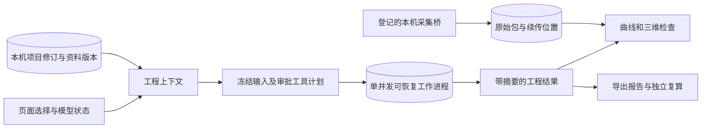

# Evolution X 工程平台

开发基线为 GitHub `codex/evolution-ix-workbench` 的 `6ec85de57ee77f3c048a8acc4afa32bbf4325b03`。Evolution X 使用独立分支 `codex/evolution-x-integrated-platform`。IX 的源码、验收记录和候选包分别保留，原有 SQLite 项目和历史研究可继续读取。

## 基线审计与处理

| 优先级 | IX 审查结论 | X 处理 |
| --- | --- | --- |
| 高 | 项目、批次、仿真、三维检查和任务分别保存在多个页面状态 | 锁定实际工作对象及配置指纹，在项目修订、任务和报告中保留来源。旧按钮仍保留原有工作流 |
| 高 | 修改资料后只能相信旧对话中曾经给出的引用 | 项目内保留文档版本、来源、页行位置和文件摘要，研究任务保存使用的资料段落 |
| 高 | 任务可以恢复中断步骤，完成后没有按原计划一键复算路径 | 从原始输入建立独立任务，同步归档轮次并逐轮审批。新输出附输入及上下文摘要 |
| 高 | WebSocket 已支持短窗口断线接续，浏览器或应用退出后需要原始文件 | 增加原始包、续传偏移和摘要的事务式持久化。设备声明或保存位置不同会拒绝拼接 |
| 中 | 有公开 CONTACT 对照、轨下模型扰动及实测边界记录，缺 31 自由度配对随机算例 | 使用同组随机速度与二系阻尼比较悬挂候选，并对最不利样本独立复算。保留 CONTACT 原模型设置 |
| 中 | 可检查 GLB、坐标约定、距离、剖切、拆解与双视窗，角度缺失 | 增加基于实际点击表面点的夹角，单位为度，第二点为顶点；尺寸按教学几何解释 |
| 中 | 本地软件及仿真检查分散 | 登记 12 个具有明确输入、判据和类别的验收场景，运行状态由 pytest JUnit 生成 |
| 待外部 | 真实云服务、独立 Windows、台架、完整 CONTACT 载荷范围和实车数据缺失 | 保持待验收状态。已有结果只对应已登记的软件、数值、合成或公开数据类别 |

## 项目到证据



1. 从工程项目栏创建或选定项目，再展开工况约束、版本与资料。上传有授权的 UTF-8 Markdown/TXT 或文字型 PDF，填写可追溯的来源。索引在本机运行。工程知识库按项目隔离，重名文件内容或来源改变时生成新版本。
2. 从高级轮轨动力学打开「在工程研究中复算当前工况」，输入「当前工况独立复算」。检查两种积分器的计划和数值容差，再审批。工程结果保留实际工况、源批次等可用字段；未绑定值保持为空。
3. 点击「从归档新建复算」和「查看归档复算计划」。逐轮批准，使用与原任务相同的参数、资料及原始数据快照。数值一致性以结果对照为准。
4. 可在研究工作台输入「随机扰动」完成固定种子的 31 自由度不确定性试验。两个均匀扰动独立施加于车速与二系横向阻尼。候选刚度为同一对中基准的 85%。报告输出分位、经验可行比例和 Pearson 样本相关，最差收益用 RK45 检查。在声明的模型之外无法推断运行安全概率。
5. 在数字孪生的在线采集页使用本机 WebSocket 采集桥，或将 CSV/JSONL/模拟会话用相同的数据契约归档。历史记录可重新载入，按声明一致的原始偏移接续。模式使用 50 Hz 垂向通道，当前观察证据只支持单部件垂向量。

## 工具、安全与验证

SQLite 迁移是新增表，项目、资料和采集保存支持事务内版本/偏移校验。应用使用有界样本、资料和计算预算。Git 工作树里的未跟踪文件以及本机工程数据库与验收产物保存在本机。项目资料的过程索引与本机研究任务与云端规划输入相互独立。云端规划仍须用户发起并审批执行，离线试验直接使用已有工程计算。

运动资产继续使用仓库内 Three.js、GLB 与参数化整车连接几何。真实求解轨迹、展示倍率和教学姿态保持独立。轮轨基准中居中左轮切线刚度低估约 35.13%，校准系数不作为整车默认输入。公开数据没有为当前车辆提供制造级尺寸或真实动态精度。长期 GPU 资源、硬件传感器和实车模型验证需要另外执行。

```powershell
.venv/Scripts/python.exe -m pytest -q --junitxml=tmp/x-junit.xml
.venv/Scripts/python.exe scripts/report_engineering_verification.py tmp/x-junit.xml tmp/x-matrix.json --commit <source-commit>
.venv/Scripts/python.exe scripts/run_browser_checks.py --suite evolution-x
.venv/Scripts/python.exe scripts/check_evolution_x_acquisition.py tmp/x-acquisition
```

公测渠道说明见 [Windows 便携版清单](windows-beta-checklist.md)。V1.0 RC1 为测试候选渠道，正式签名、独立无 Python Windows 设备及模型外部验证仍由验收清单管理。

## 验收记录

### 工程结果及边界

- 六组 31 自由度配对扰动使用种子 1234、18 m/s 和 580 m 半径的教学输入。横向 RMS 改善量的经验 5／50／95 分位为 0.001795／0.002091／0.002339 m/s²。六组候选均通过声明的数值约束。最小改善样本重复使用 RK45 后，收益差为 1.83×10⁻⁸ m/s²。
- 在 Manchester 居中左轮对照中，无量纲斜率 `k_t × δ / F` 的公开参考为 1.6864。标量 Hertz 形式 `F = C × δ^(3/2)` 固定得到 1.5，因此若精确匹配该压入量，切线预测仍低约 11.05%。全组拟合原有约 35.13% 居中切线残差还含不同位置数据间的折中。需要不同载荷及局部接触几何数据才能进一步解释，当前名义接触系数保留。
- 50 Hz 合成回环在 22.70 s 内保存 2,994 包，经历 18 次连接，两次从 SQLite 重建采集器。2,992 个包被接纳为有效记录，同时检测到一个重复包、一个迟到包与八个序号缺口。原始完整摘要和计数与一次性处理一致，Python 跟踪堆峰值约 3.48 MB。独立设备、长时持续记录及水平通道仍需验证。

### 自动化与浏览器

- 候选运行源码 `5a536bfb` 的全量 pytest 为 793 项、325 个子测试通过，失败为零。JUnit 产出的 [验收目录](../rail_vehicle/verification_matrix.py) 中 12 个实际场景全部通过。首轮回归与界面签名调整并行时触发混合版本失败，在冻结提交的全量回归中消除。Python 编译、JavaScript 语法、GLB 结构和双版本数据契约通过。
- Edge 的工程知识库、归档复算、模拟采集刷新恢复通过。三维专项覆盖 1366×768 和 1920×1080、测角、剖切、拆解、旧动画与 GLB 回退。项目栏初次加入主区占用了三维视窗高度，移至三维页侧栏后原有画布约束通过。独立 Edge 执行的 31 自由度老流程通过 DOP853、Pareto、双视窗与 RK45。
- 实际 Edge 的 1366×768 单视窗连续播放各 25 s。AMD Radeon 610M 原生路径捕获帧间隔 p95 为 16.6 ms，SwiftShader 软件路径为 55.6 ms，使用相同约 47,974 三角形的视图。两条路径在四次卸载后均回到相同文档数，JavaScript 堆约由 27.7 MB 增至 35.5 MB、28.0 MB 增至 34.0 MB。捕获回调、提交次数、显示器刷新率和 GPU 占用各有不同口径。此轮尚未区分缓存增长与长期资源滞留。
- 真实 RC1 EXE 在隔离用户配置与仅有 System32 的 PATH 上通过启动诊断。Edge 验证资料索引、白名单任务、复算、模拟数据保存和刷新恢复，退出并重新启动 EXE 后再次导出了原有复算证据。最终包运行文件还通过「动力学 → 工程研究」活跃工况验证，DOP853 与 RK45 的横向 RMS 差为 1.98×10⁻⁷ m/s²，并导出包含两种积分器和证据编号的 PDF。

### 界面与复跑

[改造前 1366](images/evolution-x/1366-home-before.png) · [改造后 1366](images/evolution-x/1366-home-after.png) · [项目资料](images/evolution-x/1366-project-knowledge.png) · [1920 浅色 115%](images/evolution-x/1920-project-light-115.png)

[三点夹角](images/evolution-x/bogie-glb-angle.png) · [整车动力学双视窗](images/evolution-x/1366-solver-workbench.png) · [模拟采集恢复](images/evolution-x/1920-acquisition-restore.png)

[RC1 独立复算](images/evolution-x/1366-exe-solver.png) · [RC1 EXE 重启恢复](images/evolution-x/1366-exe-restart.png)

工程验收矩阵、原始回环结果、参数扰动、公开接触斜率及渲染数据位于本机 `dist/Evolution-X/acceptance`。可用 `node scripts/check_evolution_x_render.cjs http://127.0.0.1:端口 输出文件.json 25` 对同一离线测试实例重跑捕获帧时间和重复卸载检查。

### 交付记录

最终候选 ZIP 位于本机 `dist/Evolution-X/verified/RailVehicle-Lab-V1.0-RC1-Windows-x64.zip`。大小为 172,355,543 字节，SHA-256 为 `7e747078dbda8eb5d3b1ff79663aba5f808f6e66b3ca000182248e2e61a3ee2f`。归档记录冻结运行源码 `5a536bfb1bc656cf1f4df5e5de1c06742b994fd0`。构建后统一了包内公测说明与反馈模板的 RC1 标题，逐项核对 8,181 个运行文件与初次 EXE 验收的文件摘要相同。更新后的便携归档专项覆盖 23 项和 14 个子测试。

本阶段保留单一研究调度器和本机确定性分析工具。可重用上下文覆盖现有分析窗口、三维检查和 31 自由度工况。全局搜索、原生硬件采集、长时间 GPU 资源诊断、完整项目多用户隔离、真实云端分析及台架与实车验收仍是交付边界。现有项目归档和备份可在单独文件中核对。
