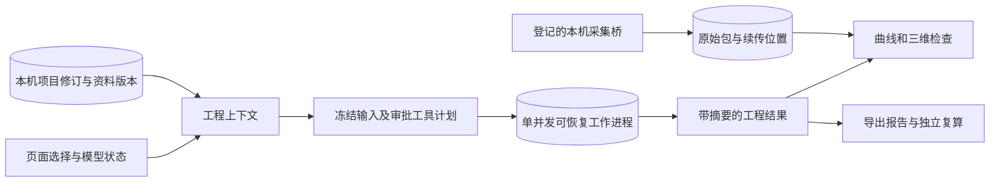

# Evolution X 工程平台

开发基线为 GitHub `codex/evolution-ix-workbench` 的 `6ec85de57ee77f3c048a8acc4afa32bbf4325b03`。Evolution X 使用独立分支 `codex/evolution-x-integrated-platform`。IX 的源码、验收记录和候选包分别保留，原有 SQLite 项目和历史研究可继续读取。

## 基线审计与处理

| 优先级 | IX 审查结论 | X 处理 |
| --- | --- | --- |
| 高 | 项目、批次、仿真、三维检查和任务分别保存在多个页面状态 | 锁定实际工作对象及配置指纹，在项目修订、任务和报告中保留来源。旧按钮仍保留原有工作流 |
| 高 | 修改资料后只能相信旧对话中曾经给出的引用 | 项目内保留文档版本、来源、页行位置和文件摘要，研究任务保存使用的资料段落 |
| 高 | 任务可以恢复中断步骤，完成后没有按原计划一键复算路径 | 从原始输入建立独立任务，同步归档轮次并逐轮审批。新输出附输入及上下文摘要 |
| 高 | WebSocket 已支持短窗口断线接续，浏览器或应用退出后需要原始文件 | 增加原始包、续传偏移和摘要的事务式持久化。设备声明或保存位置不同会拒绝拼接 |
| 中 | 有公开 CONTACT 对照、轨下模型扰动及实测边界记录，缺 31 自由度配对随机算例 | 使用同组随机速度与二系阻尼比较悬挂候选，并对最不利样本独立复算。保留 CONTACT 原模型设置 |
| 中 | 可检查 GLB、坐标约定、距离、剖切、拆解与双视窗，角度缺失 | 增加基于实际点击表面点的夹角，单位为度，第二点为顶点；尺寸按教学几何解释 |
| 中 | 本地软件及仿真检查分散 | 登记 12 个具有明确输入、判据和类别的验收场景，运行状态由 pytest JUnit 生成 |
| 待外部 | 真实云服务、独立 Windows、台架、完整 CONTACT 载荷范围和实车数据缺失 | 保持待验收状态。已有结果只对应已登记的软件、数值、合成或公开数据类别 |

## 项目到证据



1. 从工程项目栏创建或选定项目，再展开工况约束、版本与资料。上传有授权的 UTF-8 Markdown/TXT 或文字型 PDF，填写可追溯的来源。索引在本机运行。工程知识库按项目隔离，重名文件内容或来源改变时生成新版本。
2. 从高级轮轨动力学打开「在工程研究中复算当前工况」，输入「当前工况独立复算」。检查两种积分器的计划和数值容差，再审批。工程结果保留实际工况、源批次等可用字段；未绑定值保持为空。
3. 点击「从归档新建复算」和「查看归档复算计划」。逐轮批准，使用与原任务相同的参数、资料及原始数据快照。数值一致性以结果对照为准。
4. 可在研究工作台输入「随机扰动」完成固定种子的 31 自由度不确定性试验。两个均匀扰动独立施加于车速与二系横向阻尼。候选刚度为同一对中基准的 85%。报告输出分位、经验可行比例和 Pearson 样本相关，最差收益用 RK45 检查。在声明的模型之外无法推断运行安全概率。
5. 在数字孪生的在线采集页使用本机 WebSocket 采集桥，或将 CSV/JSONL/模拟会话用相同的数据契约归档。历史记录可重新载入，按声明一致的原始偏移接续。模式使用 50 Hz 垂向通道，当前观察证据只支持单部件垂向量。

## 工具、安全与验证

SQLite 迁移是新增表，项目、资料和采集保存支持事务内版本/偏移校验。应用使用有界样本、资料和计算预算。Git 工作树里的未跟踪文件以及本机工程数据库与验收产物保存在本机。项目资料的过程索引与本机研究任务与云端规划输入相互独立。云端规划仍须用户发起并审批执行，离线试验直接使用已有工程计算。

运动资产继续使用仓库内 Three.js、GLB 与参数化整车连接几何。真实求解轨迹、展示倍率和教学姿态保持独立。轮轨基准中居中左轮切线刚度低估约 35.13%，校准系数不作为整车默认输入。公开数据没有为当前车辆提供制造级尺寸或真实动态精度。长期 GPU 资源、硬件传感器和实车模型验证需要另外执行。

```powershell
.venv/Scripts/python.exe -m pytest -q --junitxml=tmp/x-junit.xml
.venv/Scripts/python.exe scripts/report_engineering_verification.py tmp/x-junit.xml tmp/x-matrix.json --commit <source-commit>
.venv/Scripts/python.exe scripts/run_browser_checks.py --suite evolution-x
.venv/Scripts/python.exe scripts/check_evolution_x_acquisition.py tmp/x-acquisition
```

公测渠道说明见 [Windows 便携版清单](windows-beta-checklist.md)。V1.0 RC1 为测试候选渠道，正式签名、独立无 Python Windows 设备及模型外部验证仍由验收清单管理。
