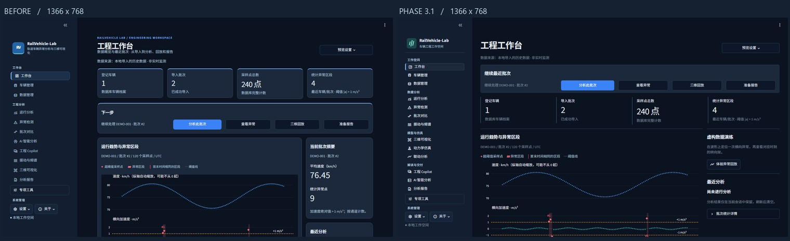
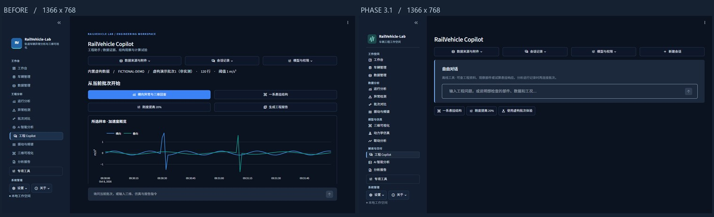
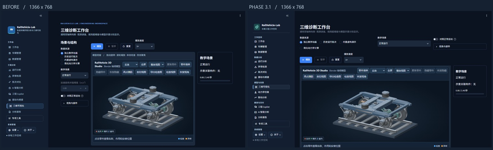
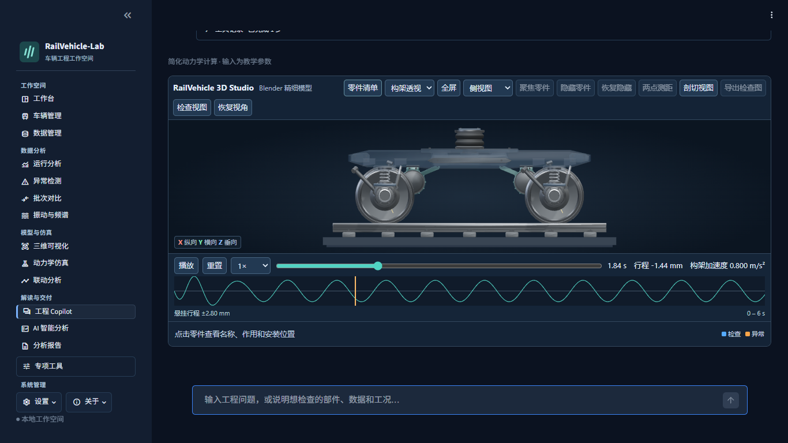

# Phase 3.1 工程工作空间

从提交 `88db091` 的界面开始，使用同一组虚构车辆、两个批次和相同的浏览器视口进行对照。截图保留默认工程视角。桌面验收覆盖 1366 × 768 和 1920 × 1080，两种尺寸都检查深浅主题。

## 从哪里开始

| 要完成的工作 | 入口 |
| --- | --- |
| 接着处理最近导入的批次，或首次登记、导入 | 工作台首屏操作区 |
| 查找车辆、编辑档案、上传及校验 CSV | 车辆管理、数据管理 |
| 查看信号、复核规则事件、对比批次、分析频谱 | 运行分析、异常检测、批次对比、振动与频谱 |
| 看模型结构、修改悬挂参数、按数据回放 | 三维可视化、动力学仿真、联动分析 |
| 自由提问、核查单次 AI 解读、导出报告 | 工程 Copilot、AI 智能分析、分析报告 |
| 历史驾驶舱、多车比较、机器学习及虚构示例 | 专项工具 |
| 切换外观 | 设置 |

## 改版前发现与实际变更

- 首次进入 Copilot 就绑定虚构批次，四个任务按钮及波形占据主要空间。现在从概览直接进入时先看到自由对话输入框。默认无车辆、无批次。资料检索、部件观察和假设参数仿真可以直接执行。涉及车辆数据的操作会提示连接数据。由分析页打开时继续携带原有批次和证据。
- 新建会话可直接点击，会话记录按上下文隔离。来源、附件、模型及权限分别收纳。已有对话的输入保留在底部，回答与证据先于详细工具日志；初始样本预览按需展开。
- 悬挂计算和数据联动原先依赖切换三维数据来源。侧栏新增两个直达入口，复用原查看器及求解器。联动分析接受原批次、时间范围及所选事件。三维结构页保留原来源切换，照顾已有操作习惯。
- 三维工作区由侧栏嵌套多个窄列改为上方场景工具、中央模型及右侧状态。数值试验单独排列参数与模型。零件树入口提前；浅色模式下，工具条、属性区采用浅色，模型用深色观察背景。暂停、逐帧、剖切、书签和导出继续使用原逻辑。
- 首页把“继续最近批次”或首次使用操作移至统计之前，趋势、最近记录和虚构练习分开呈现。车辆操作提前到列表之前；CSV 上传移至格式说明及下载示例之前。
- 去掉各页重复的英文眉题，减少指标与图表的外围边框。基于原生组件统一字号、间距、焦点、状态色和图表容器。应用继续使用 Streamlit 及现有本地 Three.js 组件；Python 算法、数据库结构、GLB 和供应商协议沿用原实现。

## 相同视口对照

## 本轮验收

- 最终全量回归通过 627 项，另有 317 个子测试通过。
- 七组 Edge / Playwright 套件通过，覆盖专业工具、无批次问答、虚构数据附件、模拟在线授权、模型回退、PDF 和会话恢复。联动页在两个分辨率下均打开了所选垂向事件的第 71 行，并返回原异常筛选。
- 改版前后各保存 76 张原始 PNG，覆盖 18 个页面及设置面板、两种主题和两个分辨率。离线对照册逐组检查了 76 对图片的解码与尺寸。

## 如何重复浏览器验收

运行 `python -m scripts.run_browser_checks --suite interface` 可生成 18 个页面及设置面板的双主题、双分辨率截图。运行 `--suite all` 还会验证模型操作、计算游标、历史区段、会话恢复、PDF、离线对话与本机模拟模型服务。准备兼容的 Playwright/Chromium，必要时用 `RAIL_PLAYWRIGHT_MODULE` 和 `RAIL_BROWSER_PATH` 指向本机安装。运行器在临时目录创建虚构数据并过滤开发机 AI 配置。

离线问答使用工具和本地知识检索。聊天历史按当前会话和数据范围保存；跨会话可下载归档。真实供应商对话质量、Windows 便携包和独立用户试用需另行验收。

## Copilot 三维播放复验

在工程 Copilot 中输入「展示蛇行运动示意」后，动画由浏览器连续推进。可以继续输入「暂停」「继续播放」或「重置」。教学动画和历史采样回放各自使用适合其数据来源的时钟。

输入「将悬挂刚度提高20%，比较振动响应」后，可以拖动计算曲线的时间轴，再通过对话控制当前模型。单说「暂停」会停在当前采样点，「暂停在2秒」会跳到指定时刻并暂停。同一场景的播放指令保留手选视角和表面显示。打开另一场景会创建新的查看器。手动拖动的位置只保存在当前打开的查看器中。

下面是 Edge 1366×768 的实测截图。侧视图中启用了构架透视，暂停后时间轴和计算曲线游标均停在 1.84 秒。显示值来自教学参数下的简化悬挂计算。

本次复验通过 632 项 pytest 测试和 317 个子测试，七组 Edge 浏览器套件全部通过。1366×768 和 1920×1080 均验证了教学动画持续播放、原位暂停与续播、重置、指定秒数定位，以及切换页面后的会话范围隔离。CSV 附件测试还验证了手动设置的 1.2 m/s² 阈值可以随附件恢复。模型服务测试使用本机模拟接口。
