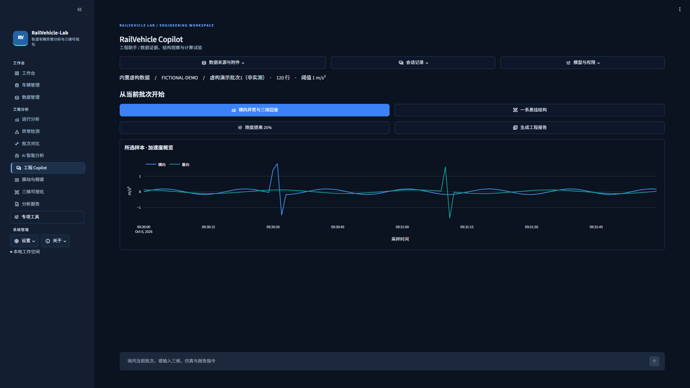
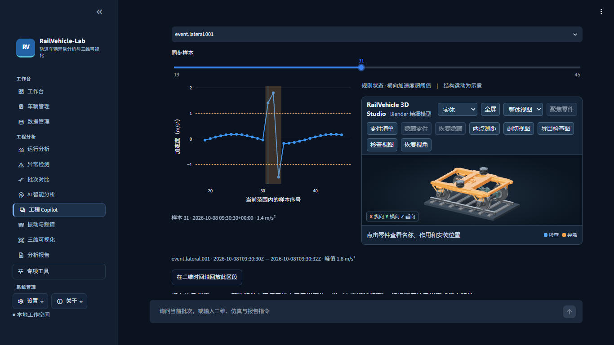
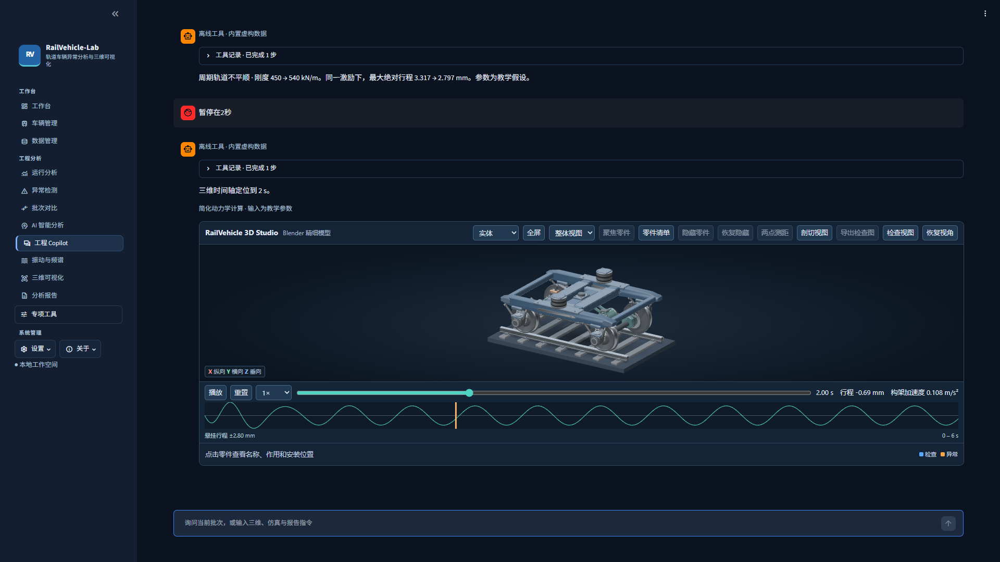
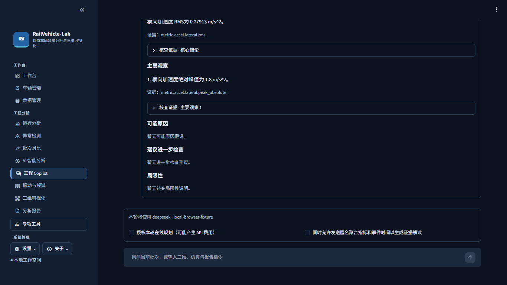

# RailVehicle Copilot · Project Evolution Phase 2

## 从异常到报告

运行 `python -m streamlit run app.py`，在左侧打开「工程 Copilot」，选择「横向异常与三维回查」。默认来源为内置虚构批次。进入「运行分析」后，也可以选定车辆、时间范围和阈值，再点击「在 Copilot 中分析」。

1. 在工具记录中核对实际执行的质量检查、统计、异常检测、频谱与知识检索。点击证据下的区段选择器，核对原始波形、绝对阈值和事件峰值。
2. 拖动「同步样本」，曲线游标、数值和 GLB 的规则高亮一起更新。「在三维时间轴回放此区段」按原样本指纹打开完整三维工作台。「查看独立教学演示」可观察相关结构的示意运动。
3. 输入「将悬挂刚度提高20%，比较振动响应」，查看相同激励下两次计算的行程。输入「暂停在2秒」可定位三维播放器。计算使用有单位的教学参数。
4. 输入「根据本次分析生成完整报告」，下载本机生成的 PDF。报告标出数据来源，包含批次统计、规则事件、曲线，以及本会话实际完成的振动计算、对比、简化仿真或资料引用。在线解读须同时通过证据、范围与所选数据指纹检查才能进入报告。

会话 CSV 接受项目的 UTF-8 导入格式，可在同一文件中选择不同车辆。每次限 5,000 条样本、2 MB。历史大批次可先缩小分析窗口。会话 CSV 的波形和三维在对话内联动，历史库中的数据另有完整回放入口。数据库沿用原有模式。

## 继承的能力与新增接口

起点为 `codex/project-evolution` 上的 `717f2a9`。Phase 1 已有 54 件 GLB、轮轴及悬挂连接、八个计算工况、频谱采样门槛、行级证据指纹和历史回放；开发记录列出 594 项用例和 317 个子测试。既有 AI 分析中心支持受证据约束的单次解读。本阶段新增同批次多轮工具执行、会话级附件、对话内三维、引用检索和带上下文的报告。三维资源沿用已验收的本地文件。[Phase 1 工程记录](project-evolution.md)

| 入口或协议 | 实际作用 |
| --- | --- |
| `Dataset` / `Work` | 绑定来源、车辆、批次、样本范围、阈值与数据指纹，按需计算统计量。主批次、对照批次及资料共同确定可见会话。 |
| `local_plan` / `online_plan` | 离线按已支持的工程指令生成计划。在线接收模型流式函数调用，组装后校验整份计划。 |
| `TOOLS` / `execute` | 调用格式为 `{"tool":"review","args":{"axis":"lateral","ordinal":1}}`。所有字段通过注册表的 JSON Schema 检查。工具执行产生状态、时间、结果及相关证据。 |
| `stream_analysis` | 允许模型选择本批次已有的聚合证据与来源。服务端校验 ID、轴向、批次与结论范围，再逐条显示。针对单个事件的解读只能引用选中的事件。 |
| `studio_command` | 把需要的表面模式和播放动作交给原有 Three.js 组件。重复收到同一命令不会重置用户当前视角或播放位置。 |

15 项工具覆盖车辆参数、批次目录、样本范围、采样质量、分轴统计、超阈值区段、指定事件复核、振动特征、同车两批对比、资料检索、结构观察、工况目录、悬挂响应、三维时间轴和 PDF。会话内可继续追问「下一个异常」「第3至5行」「一系悬挂独立显示」等。规划器每轮最多执行八步，禁止重复调用；进程同时接受至多四个作业，每轮预算 45 秒。停止操作会在工具或流片段之间取消，已开始的数值例程及网络读取可能要到下一检查点才释放线程。

## 知识、隐私与历史

本地索引有七条总成说明以及四条有出处的工程笔记，覆盖悬挂、轮轨、牵引制动、采样和振动分析。检索按标题与正文匹配中文相邻双字及英文词项，返回最多三段。命中项显示编号、标题和来源。用户可提供有使用权的一份 Markdown 或文字型 PDF；PDF 引用保留页码。PDF 解析需 `python -m pip install -e ".[knowledge]"`，每份 PDF 最多 40 页，提取文字累计 128 KB。扫描件需先做文字识别。

默认使用本机的确定性任务规划。在线服务复用项目配置的 OpenAI 或 DeepSeek，模型名在「模型与权限」中选择。每轮独立授权在线规划、匿名指标及事件时间、匹配的用户资料摘录。在线规划会发送用户输入的问题、最近的工具选择和检索摘要；样本表、CSV 文件与完整文档留在本机。公开演示模式使用虚构批次与离线工具。

会话历史保存在当前浏览器连接对应的服务端会话内，至多十个对话，每个对话十二轮。需要跨重启保存时，下载对话 JSON。重新打开后可阅读历史文字或选择问题按当前数据复算。展示历史文件采用纯文本，重新生成工程证据须执行本机工具。

## 复现与部署

在项目虚拟环境执行 `python -m pytest -q` 与 `python scripts/validate_bogie_glb.py`。浏览器验收使用独立虚构 SQLite、仅绑定回环地址的 Streamlit 和本机 Edge。设置 `RAIL_PLAYWRIGHT_MODULE` 和 `RAIL_BROWSER_PATH` 后，运行 `python -m scripts.run_browser_checks --suite copilot`。参数 `--suite copilot-stream` 会另外启动本机模拟模型，经过实际 SDK 流式协议检查逐轮授权、限流、重试和停止。参数 `--suite all` 还覆盖模型、动力学、工作台恢复和前端业务。

2026-11-20 的 Windows 验收中，完整 Python 回归通过 625 项测试和 317 个子测试，其中 31 项专门覆盖 Copilot。Edge 在 1366×768 与 1920×1080 窗口均成功将第一段横向事件定位到第 31 条样本。该条读数为 1.400 m/s²，区段峰值为 1.800 m/s²。两种窗口从快捷指令点击到回查按钮可用分别用时 2.04 秒、0.48 秒，包含页面重绘。并行运行浏览器与回归测试期间，120 行虚构样本的六步工具链预热后连续执行 25 次，中位耗时 11.95 ms，P95 为 49.96 ms。这些是本机采样值。

使用相同激励将教学刚度从 450 增加到 540 kN/m，峰值悬挂行程从 3.317 降至 2.797 mm。三维播放器在 2 秒处停于索引 200。独立读取生成的四页 PDF，确认含虚构数据标识、工具记录、刚度对照与同车两批数据对比。真实供应商鉴权和付费模型响应仍待另行验收。

现有桌面应用依赖 Python、Streamlit 的会话连接、SQLite 和 PDF 后端。保留 Streamlit 与既有 Three.js 查看器可继续使用 Windows 启动器。若制作纯静态竞赛演示，建议先把固定虚构批次的已算证据、样本、教学响应及 GLB 一起导出，浏览器按行号回放；在线模型调用、任意输入的计算和 PDF 生成应接入带授权的独立后端。Qoder Sites 个人 Free 版支持静态网页，数据库和存储能力随产品方案而异。当前评估未进行部署或认定参赛资格，开发来源以实际 Git 记录为准。[Qoder Sites 官方文档](https://docs.qoder.com/zh/qoder/sites)

